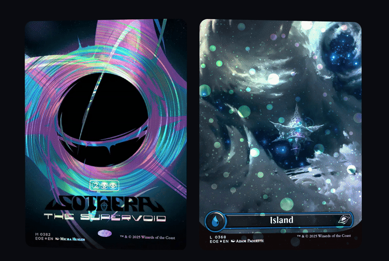
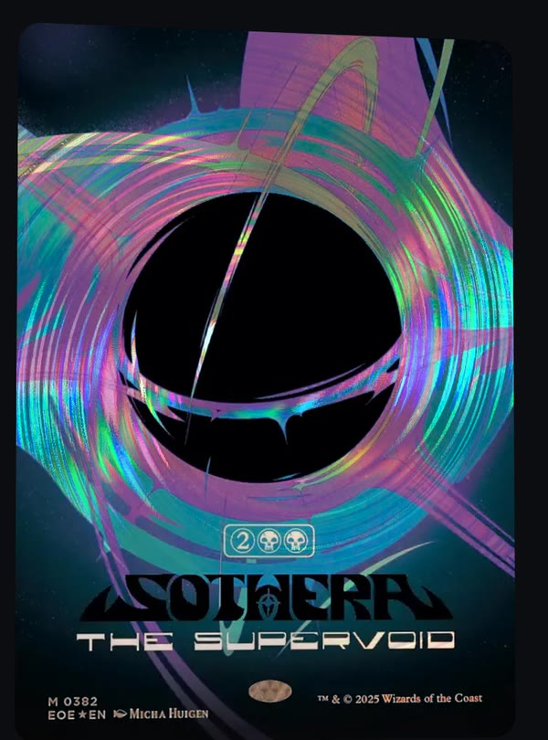
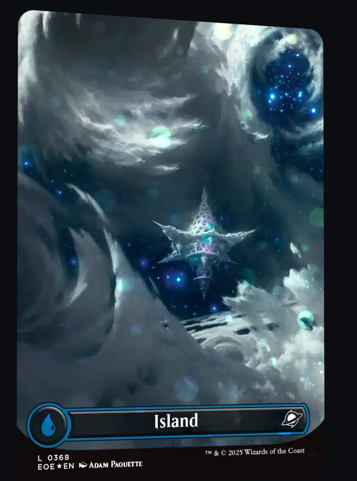
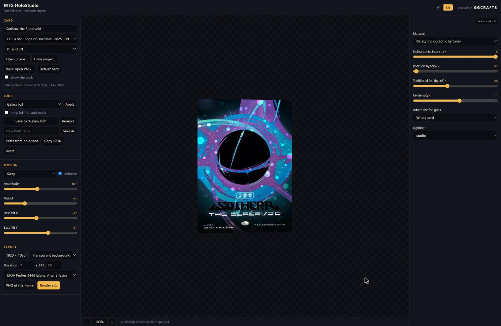
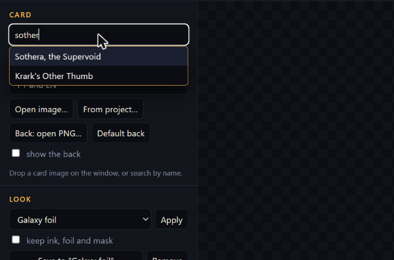
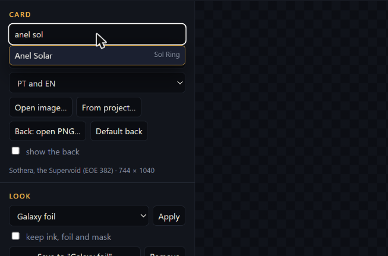

<div align="center">

# MTG HoloStudio

**Real holographic foil for every card you talk about.**
Type a card name, pick a finish, press render: a physically lit foil card, at 1920 × 1080, with alpha.



<sub>Sothera, the Supervoid (EOE #382) in <b>Golden vortex</b> · Island (EOE #368) in <b>Galaxy foil</b>. Both exported straight from the Studio.</sub>

[English](#why-it-exists) · [Português](#português)

</div>

---

## Why it exists

Card content lives and dies on one moment: the foil catching the light. Filming real cards takes a rig,
the right lamp and the card in your hands. Fake glare in an editor looks fake.

MTG HoloStudio renders the foil instead of faking it. Under the art there is an actual holographic sheet,
simulated by the [holo.spot](https://www.holo.spot) engine: diffraction gratings that split light into a
spectrum depending on the angle you look from. The card art is printed on top like ink on metal: dark ink
swallows the shine, light areas let it through, white underprint blocks it where a real print would. Tilt
the card and the rainbow moves the way it moves in your hand.

I built it for my own Magic channel and I am opening it to every **MTG and TCG content creator**: shorts,
reels, deck techs, unboxing overlays, thumbnails, stream alerts, set reviews. If it helps you make
something, that is the whole point. Use it, break it, send looks back. I hope the community makes it theirs.

## What you get

<table>
<tr>
<td width="50%" align="center"><a href="docs/media/sothera-golden-vortex.webm"></a><br><b>Golden vortex</b> · <a href="docs/media/sothera-golden-vortex.webm">2 s WebM with alpha</a></td>
<td width="50%" align="center"><a href="docs/media/island-galaxy-foil.webm"></a><br><b>Galaxy foil</b> · <a href="docs/media/island-galaxy-foil.webm">2 s WebM with alpha</a></td>
</tr>
</table>

- **A physical foil, not a filter.** Spectral diffraction in 3D, six holo.spot materials (Prism Rainbow,
  Gold Shatter, Nebula Glitter, Sky Sparkle, Gilded Vortex, Volume Hologram) plus two of its own.
- **Galaxy and Surge, done properly.** Both are holographic profiles driven by a map: the grey tone of each
  pixel sets the direction and pitch of its microscopic grating, so a smooth gradient in the map becomes a
  smooth sweep of colour across the card. Galaxy adds star noise and the traditional Magic foil underneath,
  masked by the art, as on the real printing.
- **Print-aware masks.** A contrast map of the art with levels (white shows foil, black almost none), foil
  on the whole card, the art only, the frame only or your own PNG mask, an opaque text box.
- **Looks you can keep.** Every look stores every parameter. Save, overwrite, remove. Nine base looks ship
  with the Studio: Classic foil, Surge foil, Galaxy foil, Foil on art only, Concentric rainbow,
  Galaxy (glitter), Cracked ice, Dotted, Golden vortex.
- **Motion that loops.** Sway, sweep, orbit and a seamless 360° spin that shows your custom back. Rendering is
  deterministic and frame-exact: with the duration equal to the motion period, the clip loops perfectly.
- **Exports for any pipeline.** 1920 × 1080 PNG, ProRes 4444 MOV with alpha, VP9 WebM with alpha, MP4, or the
  raw PNG sequence.
- **Simple or deep.** A basic mode with a handful of sliders, an advanced mode with everything, zoom from 20%
  to 500%, interface in English or Portuguese.



## Any card, by name and edition (Scryfall)

Cards come from [Scryfall](https://scryfall.com) while you work; nothing is bundled.

**1. Type a name, the way you remember it.** The search merges three sources and ranks them by similarity:
Scryfall autocomplete for English names, a search of Portuguese printed names (by word stems, so a typo at the
end of a word does not empty the list), and Scryfall's fuzzy match for names with words missing or out of
order. Portuguese suggestions show the English name beside them.

<table>
<tr>
<td align="center"><br><sub><code>sother</code> → Sothera, the Supervoid</sub></td>
<td align="center"><br><sub><code>anel sol</code> → Anel Solar (Sol Ring)</sub></td>
</tr>
</table>

**2. Pick the printing.** The second menu lists every paper printing with an image, newest first, labelled
with set code, collector number, set name, year, language and finish. For Sothera that is:

```
PEOE #115s · Edge of Eternities Promos · 2025 · EN · promo, foil only
PEOE #115p · Edge of Eternities Promos · 2025 · EN · promo
EOE #386   · Edge of Eternities · 2025 · EN · full art, showcase, inverted, foil only
EOE #382   · Edge of Eternities · 2025 · EN · borderless, full art, foil only
EOE #360   · Edge of Eternities · 2025 · EN · full art, showcase, inverted, foil only
EOE #115   · Edge of Eternities · 2025 · EN
```

A language filter chooses Portuguese and English (Portuguese first), one language, or any. Double-faced
cards get a front/back switch. The Studio loads the high-resolution PNG of the printing you pick.

**3. Or bring your own art.** Open an image, drop it on the window or leave it in `cards/`. Proxies,
custom cards, other TCGs (Pokémon, Lorcana, One Piece, Flesh and Blood, Yu-Gi-Oh!): anything card-shaped
gets the same foil.

## Let Claude animate your cards

The Studio is also a **render engine you can script**, and the repository ships a Claude
**Skill** and a Claude **Agent** that use it. Ask for cards in plain words; Claude finds the printing on
Scryfall, picks the look, renders the clip, checks a frame and hands you the file, ready for the next tool in
your pipeline.

> *"Make a 4-second seamless loop of the borderless Sothera in gilded vortex, ProRes with alpha for After Effects."*
>
> *"Render my top 5 commanders as surge-foil sways for a short, WebM."*
>
> *"Give me a 360° reveal of Sol Ring and first/last-frame stills for the video generator."*

| | Where | What it does |
|---|---|---|
| **Skill** `holostudio` | [`.claude/skills/holostudio/SKILL.md`](.claude/skills/holostudio/SKILL.md) | Teaches Claude the whole tool: finding cards by name, set and collector number, every look, motion, format and parameter, recipes, and how to feed other panels. |
| **Agent** `holostudio-animator` | [`.claude/agents/holostudio-animator.md`](.claude/agents/holostudio-animator.md) | A card-animation specialist: resolves printings, chooses looks that match the real finish, renders one card at a time, verifies every clip and reports paths with hand-off notes. |

Open the repository in [Claude Code](https://claude.com/claude-code) and both are picked up automatically.

**HoloStudio as a layer in other generation panels.** The output is designed to be the card layer of
something bigger:

| Destination | Use |
|---|---|
| After Effects, Premiere, DaVinci, Final Cut | MOV ProRes 4444 with alpha over any background |
| Remotion, HyperFrames, Motion Canvas, web pages | WebM VP9 with alpha as a transparent video layer |
| AI image-to-video and first/last-frame generators | stills at chosen instants, so the generated shot keeps the real card and the real foil |
| Thumbnails and posts | a still with alpha into your design tool |
| Blender, Nuke, custom pipelines | the PNG sequence |

### The renderer behind it

`render.mjs` drives the same panel headlessly in your installed Chrome or Edge. No dependencies.

```bash
node render.mjs --card "Sothera, the Supervoid" --set eoe --number 382 --look "Golden vortex" --duration 4 --format mov
node render.mjs --card "anel solar" --look "Classic foil" --motion flip --period 3 --duration 3
node render.mjs --image cards/my-card.png --look "Cracked ice" --render still
node render.mjs --list-looks
```

It prints JSON with the printing that was rendered and the absolute path of the clip. Every option is
documented at the top of [`render.mjs`](render.mjs) and in the skill.

The same controls exist as URL parameters, for any tool that can open a page:

```
http://127.0.0.1:4517/holofoil/?card=Island&set=eoe&number=368&look=Galaxy%20foil&motion=sway&duration=4&render=webm
```

And in the browser console, as `window.holostudio`: `loadCard({ name, set, number, lang })`,
`applyLook(name)`, `setParams({ id: value })`, `setMotion(type, options)`, `render(options)`, `still(t)`,
`looks()`, `params()`.

## Quick start

You need [Node.js](https://nodejs.org) 20 or newer. Nothing to install.

```bash
git clone https://github.com/ggcrafts/MTG_Holostudio.git
cd MTG_Holostudio
node server.mjs
```

On Windows, double-click `MTG HoloStudio.cmd`. The Studio opens at http://127.0.0.1:4517/holofoil/.

- Clip export (MOV, WebM, MP4) needs `ffmpeg` on the PATH, or `FFMPEG_PATH`. Without it you get the PNG sequence.
- The headless renderer needs Chrome, Edge, Brave or Chromium (or `CHROME_PATH`).
- On a weak machine, add `?quality=low` to the address.

## Make your own maps

- **Galaxy** (`holofoil/maps/galaxy.png`): greyscale. The same tone is the mask (where the foil is) and the
  hue (which colour, at which angle, that point lights up).
- **Surge** (`holofoil/maps/surge.png`): red channel = lines (mask), green channel = tone; blue is ignored.
  Switch between the two readings in the Mask tab, "Pattern channels".

Paint them in Photoshop, save over the PNG or open your own from the Studio.

## Folders

| Path | What |
|---|---|
| `server.mjs` | Local server (127.0.0.1 only): files, looks, uploads, ffmpeg export, automation |
| `render.mjs` | Headless renderer for scripts and Claude |
| `holofoil/` | The Studio: `index.html`, `style.css`, `app.js` (foil and ink compositing, Galaxy and Surge shaders), `i18n.js` |
| `holofoil/presets-base.json` | Base looks |
| `holofoil/maps/`, `holofoil/bumps/` | Holographic profiles and relief maps |
| `.claude/skills/`, `.claude/agents/` | The Claude Skill and Agent |
| `docs/media/` | The examples on this page |
| `vendor/holospot`, `vendor/three` | Holographic engine and three.js (do not edit) |
| `cards/`, `data/`, `output/` | Your art, your looks and uploads, your renders (outside Git) |

## Contributing

Looks are JSON: save one you love in the Studio, find it in `data/holofoil/presets/` and open a pull request
or an issue with a clip. New maps, materials, motions, translations and fixes are all welcome.

---

## Português

**Foil holográfico de verdade para qualquer carta.** Você digita o nome, escolhe o acabamento e renderiza:
uma carta com folha holográfica iluminada fisicamente, em 1920 × 1080, com alpha.

Fiz o MTG HoloStudio para o meu canal de Magic e abri para **criadores de conteúdo de MTG e de outros TCGs**:
shorts, reels, deck techs, thumbnails, alertas de live, review de coleção. Espero que a comunidade use,
quebre, melhore e mande looks de volta.

- **Busca no Scryfall por nome e edição.** Digite como lembrar, em inglês ou português, até com erro
  (`anel sol` → Anel Solar). O segundo menu lista todas as versões em papel: coleção, número, ano, idioma e
  acabamento (sem borda, showcase, promo, só foil). Ou use a sua própria arte, de qualquer TCG.
- **Looks completos.** Cada look guarda todas as propriedades; nove looks de base, incluindo Galaxy foil e
  Surge foil como perfis holográficos guiados por mapa.
- **Exportação para qualquer pipeline.** PNG, MOV ProRes 4444 com alpha, WebM com alpha, MP4 ou sequência
  PNG; com a duração igual ao período do movimento, o clipe fecha em laço.
- **Skill e Agent para o Claude** (em inglês, em `.claude/`). Peça em palavras ("um loop de 4 segundos da
  Sothera sem borda em vórtice dourado, MOV com alpha"): o Claude acha a versão no Scryfall, escolhe o look,
  renderiza pelo `render.mjs`, confere um quadro e entrega o arquivo pronto para o After Effects, o Remotion,
  o HyperFrames ou um gerador de vídeo por IA, usando o painel como gerador de animação das cartas.

Para rodar: Node.js 20+, `node server.mjs` (no Windows, dois cliques em `MTG HoloStudio.cmd`) e abra
http://127.0.0.1:4517/holofoil/. A interface tem chave PT/EN no topo.

---

## Credits and licences

- MTG HoloStudio: MIT licence, © 2026 GGLABS ([`LICENSE`](LICENSE)). Created by **GGCRAFTS**.
- Holographic engine: [holospot](https://github.com/dmitrykurash/holospot) by Dmitry Kurash, MIT
  ([`vendor/holospot/LICENSE`](vendor/holospot/LICENSE)). `vendor/holospot` carries only what is needed to run.
- [three.js](https://threejs.org), MIT ([`vendor/three/LICENSE`](vendor/three/LICENSE)).
- Card data and images come from [Scryfall](https://scryfall.com) at run time. The only card images in the
  repository are the example renders in `docs/media/`.

MTG HoloStudio is unofficial Fan Content permitted under the
[Wizards of the Coast Fan Content Policy](https://company.wizards.com/en/legal/fancontentpolicy). Not approved
or endorsed by Wizards. Portions of the materials used are property of Wizards of the Coast. ©Wizards of the
Coast LLC.
